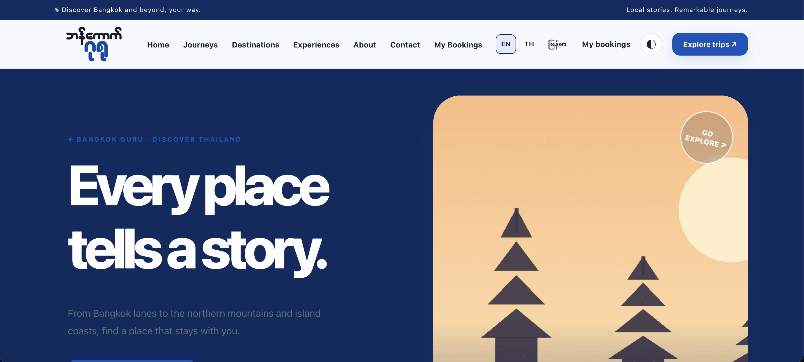
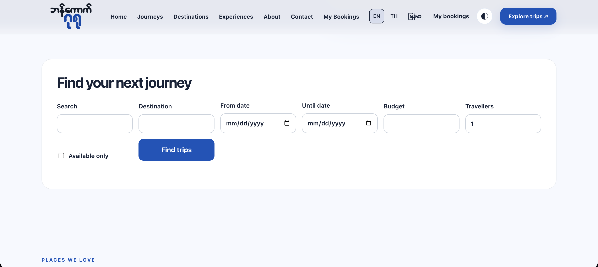
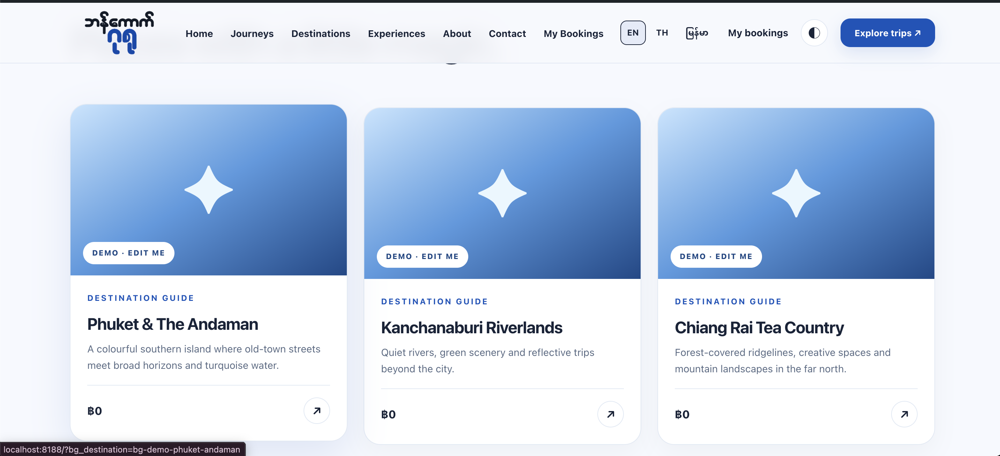
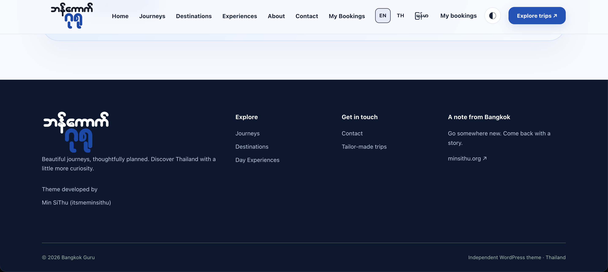

# Bangkok Guru v0.13 — Theme + independent Booking Plugin

**Developer:** Min SiThu (itsmeminsithu)
**Website:** https://minsithu.org
**License:** GPL-2.0-or-later for original source code (see individual packages).
**Status:** Developer / user-testing beta. Not certified for live payment processing.

## If you just want to install it on WordPress

Get the two files from the [v0.13.0 release](https://github.com/itsmeminsithu/Bangkok-Guru/releases/tag/v0.13.0) and upload them in WordPress admin. No Git, no code:

1. **Theme:** `Bangkok-Guru-WordPress-Theme-v0.13.0.zip` — Appearance → Themes → Add New → Upload Theme → Activate
2. **Plugin:** `Bangkok-Guru-Bookings-Plugin-v0.13.0.zip` — Plugins → Add New → Upload Plugin → Activate (theme first, then plugin)

After activation, follow the demo import prompt in the theme, or use Appearance → Bangkok Guru Setup. The source in this repo is for developers. WordPress users only need the two release files above.

## Preview

**https://itsmeminsithu.github.io/Bangkok-Guru/**

WordPress cannot run on GitHub Pages, so that page is not the theme running. It is a static page with screenshots of the design:






## Repo layout

- `wordpress-theme/bangkok-guru/` — the theme. 4 home layouts, Royal Blue/Black/White palette, custom logo, Elementor widgets, day/night, RTL, basic SEO.
- `wordpress-plugin/bangkok-guru-bookings/` — content types, inventory, booking/waitlist/enquiry, WooCommerce integration, date-and-seat search, customer dashboard, verified reviews, Thai/English/Myanmar public UI.
- `local/` + `scripts/` — local dev with Docker, WordPress, MariaDB, WP-CLI and Mailpit. Site on **8188**, test email on **8189**. It does not use 3000/3100.
- `tests/` — mocked PHP state tests, source validation, local WooCommerce smoke test (no real funds).
- `docs/` — migration, sandbox payment checklist, privacy/security notes, release gates.

## Run it locally on a Mac

1. Install Docker Desktop and open it (`open -a Docker`). Check the engine is running.
2. Unzip the GitHub Source archive to `~/Downloads/Bangkok-Guru-v0.13` (or any folder).
3. Run:

```bash
cd ~/Downloads/Bangkok-Guru-v0.13
chmod +x scripts/*.sh
./scripts/start-mac.sh
```

4. Open **http://localhost:8188** and finish the WordPress installer (your own admin credentials).
5. Run:

```bash
./scripts/enable-theme.sh
```

6. In WordPress admin: **Appearance → Bangkok Guru Setup → Create four demo homepages**, then pick the homepage you want. Tour demos are **not bookable** until you set price/date/seats.
7. Guest booking link emails are at **http://localhost:8189** (Mailpit). Mail is trapped locally and not delivered.
8. Optional WooCommerce in this local setup only:

```bash
BGX_INSTALL_WOO=1 ./scripts/enable-theme.sh
./scripts/sandbox-check.sh
```

Stop it without deleting the database: `./scripts/stop-mac.sh`. Docker may download images on the first run. Localhost on your Mac is not public hosting and is not reachable from the internet.

## Installing on an existing site

**Order matters.** Back up the database and `wp-content` first. Upgrade the active Bangkok Guru **theme to v0.13 first**, then install/activate **Bangkok Guru Bookings plugin v0.13**. The plugin is blocked from activating alongside an active old v0.11 theme, to stop duplicate function names. Existing `bg_*` content and the `wp_bg_inventory` table are reused, not renamed or deleted.

- Appearance → Themes → Upload `Bangkok-Guru-WordPress-Theme-v0.13.0.zip` and activate/update.
- Plugins → Add New → Upload `Bangkok-Guru-Bookings-Plugin-v0.13.0.zip` and activate.
- Settings → Permalinks → Save Changes.
- Pages `My Bookings` and `Find Trips` are created automatically if missing.
- Tour content and requests stay in the database across theme switches **as long as the Booking plugin stays active**. Another theme still has to provide templates/styles or use the plugin shortcodes.
- Install WooCommerce **separately** only if you use paid checkout. Use its sandbox gateway first, then test the full flow, including refunds and late events.

## What it does

**Homepages.** Four styles: Curated Travel · Bright Day Experiences · Immersive Destinations · Next Departures. Editable from admin. Elementor widgets keep their design controls.

**Booking and payments.** Atomic seat holds, availability, waiting list, unique references, prices, early bird, deposit %, due date, balance invoice. WooCommerce goes through `WC_Order` APIs for HPOS compatibility. Financial-state changes check order ID, paid amount and currency. Refund, late and ambiguous cases go to manual review. WP-Cron needs a real scheduler on production or hold expiry will be late.

**Search and customer access.** Archives filter by keyword, place, budget, departure from/to dates, travellers and seats available. `[bangkok_guru_trip_search]` searches across all travel types. `[bangkok_guru_my_bookings]` is the dashboard where logged-in users see their own bookings. Guests get a **15-minute, email-verified private access link**, and cannot list bookings by guessing a public reference.

**Languages.** Public booking/search/dashboard/review UI has a locale switcher for Thai, English and Myanmar, with locale-specific fields editable on each trip. English stays as the fallback when a translation is missing. **Not every legacy theme demo sentence is translated.** Homepage/footer text and other static Customizer fields need translating separately, or use a multilingual plugin if you need full site management and SEO hreflang. User-entered text is not translated automatically.

**Reviews.** Only authenticated users whose matching trip is completed and has status `paid` or `confirmed` can review. One review per booking. Reviews stay **pending admin moderation**; only approved reviews and ratings are public. A guest booking can be looked up with the private link, but the booking has to be linked to an authenticated account through an admin-approved verification process before a review can be submitted. Schema ratings do not guarantee Google rich results.

**Elementor, accessibility, SEO.** Custom Elementor widgets with Style tabs, custom logo, 8 global colors, RTL-ready stylesheet, conditional styles, accessible focus states, lazy loading for featured images, SEO metadata and structured tour information. Install one SEO plugin if you need multilingual sitemaps/canonical/hreflang at scale.

## Limitations

- Stripe/PayPal or any other gateway cannot be certified without real sandbox credentials and a running WooCommerce site to test end to end.
- Payments in `tests/woo-local-smoke.php` call `payment_complete()` on isolated local orders **for testing only. No real card is charged**.
- High-concurrency booking, chargebacks and late-webhook behaviour from external gateways need staging load tests.
- SMTP delivery, email privacy and regional regulation depend on the production host.
- This package **does not embed commercial theme code** from Veya. The design is original, reference only.

Read `docs/RELEASE_GATES.md` and `docs/SECURITY_AND_MIGRATION.md` before taking live bookings.

## Demo site import (v0.13, opt-in)

On activation, Appearance → Bangkok Guru Setup asks **Yes, install my demo website / No thanks**. It offers four homepages, 18 editorial travel entries (6+6+6), original travel illustrations, FAQ/About/Contact/Travel Journal and example articles. Running it again does not overwrite existing content. Prices, dates and places are illustrative. Demo bookings are blocked in the UI and on the server side of the booking submission.

From a Mac terminal, after `start-mac.sh` and `enable-theme.sh`:

```bash
./scripts/import-demo.sh travel
# or daylight / immersive / departures
```

See docs/DEMO_SETUP_MY.md and docs/DEMO_PUBLISH_CHECKLIST.md. Local Docker bind mounts are read-only on purpose; do not try to update the mounted theme from the WordPress dashboard. External previews for customers need properly configured HTTPS hosting.
